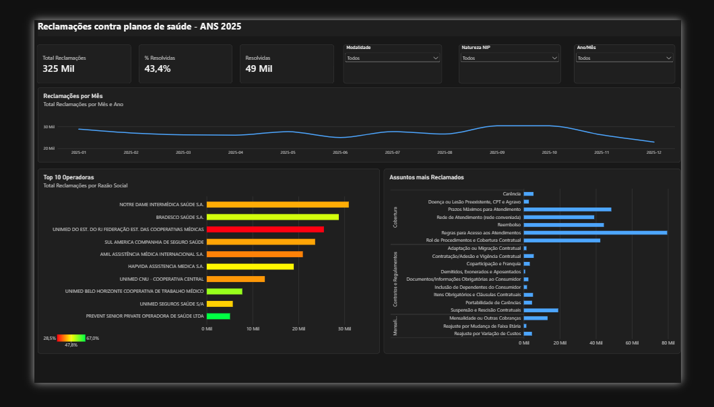
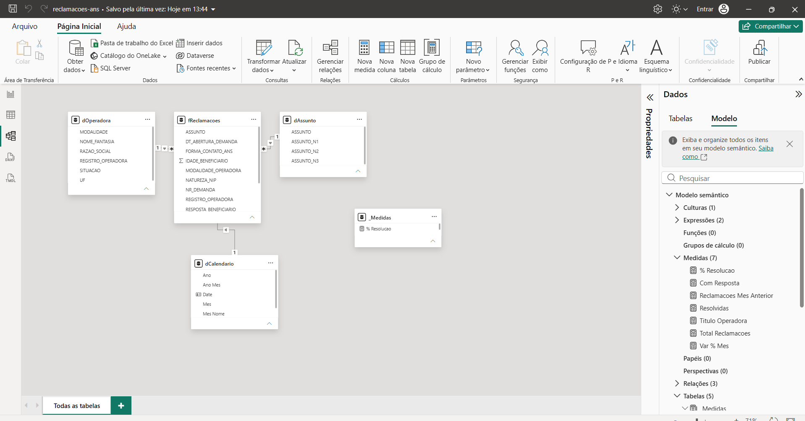
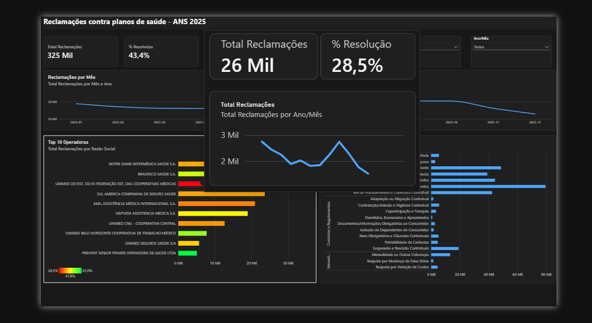
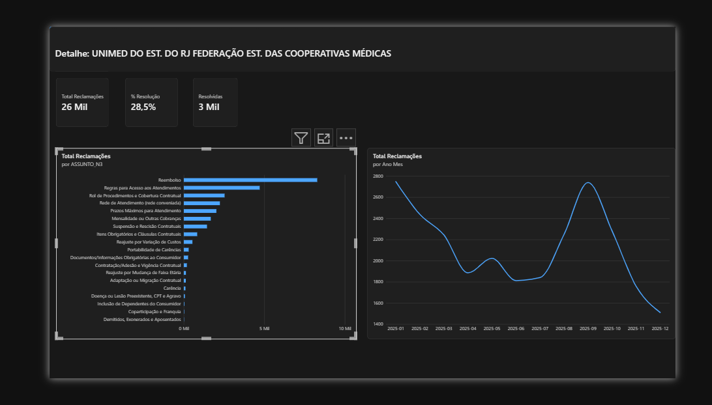

# Reclamações contra planos de saúde · ANS 2025

Dashboard em **Power BI** sobre as 325 mil reclamações de beneficiários de planos de saúde registradas na ANS (Agência Nacional de Saúde Suplementar) em 2025. O projeto vai do CSV bruto até o painel: tratamento no Power Query, modelo estrela, medidas DAX e recursos de navegação (drill-through, dica de ferramenta personalizada e filtro cruzado).



## Perguntas que o painel responde

- Quantas reclamações chegaram por mês, e quais meses tiveram pico?
- Quais operadoras concentram mais reclamações e quais resolvem pior?
- Quais são os assuntos mais reclamados, do grupo (Cobertura, Contratos, Mensalidades) até o assunto específico?
- Para uma operadora específica: do que os beneficiários dela reclamam e como isso evoluiu no ano?

## Principais achados

- **Regras para Acesso aos Atendimentos** é o assunto mais reclamado do ano (79,5 mil), seguido de **Prazos Máximos para Atendimento** (48,5 mil) e **Reembolso** (44,4 mil).
- O volume teve pico em **setembro e outubro** (cerca de 30,3 mil por mês) e caiu em dezembro (23 mil).
- No top 10, a **Unimed do Estado do RJ** combina volume alto (25,5 mil) com a **pior taxa de resolução (28,5%)**. O principal motivo das reclamações contra ela é **reembolso** (8,3 mil), quase o dobro do segundo assunto.
- A **Prevent Senior** tem a melhor taxa de resolução do top 10 (67,0%).

## Modelo de dados (estrela)



| Tabela | Tipo | Conteúdo |
|---|---|---|
| `fReclamacoes` | Fato | 1 linha por reclamação (NIP), 13 colunas |
| `dOperadora` | Dimensão | Operadoras ativas + canceladas, com modalidade, UF e situação |
| `dAssunto` | Dimensão | 19 assuntos em hierarquia de 3 níveis (N1 > N2 > N3) |
| `dCalendario` | Dimensão | Calendário gerado em DAX, marcado como tabela de datas |
| `_Medidas` | Medidas | Todas as medidas DAX num só lugar |

Relacionamentos 1:\* com filtro em direção única, da dimensão para a fato.

## Qualidade de dados: o que foi encontrado e tratado

1. **Integridade referencial.** 5.727 reclamações (1,8%) eram de 127 operadoras que não estão mais no cadastro de ativas, porque foram canceladas depois da reclamação. Com uma dimensão só de ativas, essas reclamações apareceriam como "(em branco)". Solução: a `dOperadora` junta o cadastro de **ativas e canceladas** (com a coluna `SITUACAO`), e todas as chaves passam a ser encontradas.
2. **Espaços sobrando.** A coluna `ASSUNTO` tinha 40 valores distintos, mas só 20 assuntos reais. Metade vinha com espaço no fim ("Carência" e "Carência "). Solução: *Aparar* na fato, antes de derivar a dimensão.
3. **Caractere corrompido na origem.** Duas reclamações traziam "Prazos M¿ximos" no lugar de "Prazos Máximos", o que gerava um assunto duplicado. Solução: *Substituir valores* na fato.
4. **Denominador do % de resolução.** 212 mil reclamações não têm resposta do beneficiário. Calcular o percentual sobre o total daria um número enganosamente baixo. Por isso o `% Resolucao` é calculado **só sobre quem respondeu**.

## Medidas DAX

```dax
Total Reclamacoes = countrows(fReclamacoes)

Com Resposta =
calculate([Total Reclamacoes], fReclamacoes[RESPOSTA_BENEFICIARIO] <> "")

Resolvidas =
calculate(
    [Total Reclamacoes],
    fReclamacoes[RESPOSTA_BENEFICIARIO] in {"Sim, resolvido", "Cobertura dentro do prazo"}
)

% Resolucao = divide([Resolvidas], [Com Resposta])

Reclamacoes Mes Anterior =
calculate([Total Reclamacoes], dateadd(dCalendario[Date], -1, month))

Var % Mes =
divide([Total Reclamacoes] - [Reclamacoes Mes Anterior], [Reclamacoes Mes Anterior])

Titulo Operadora =
"Detalhe: " & selectedvalue(dOperadora[RAZAO_SOCIAL], "selecione uma operadora")
```

A `dCalendario` também é criada em DAX:

```dax
dCalendario =
var _ini = date(year(min(fReclamacoes[DT_ABERTURA_DEMANDA])), 1, 1)
var _fim = date(year(max(fReclamacoes[DT_ABERTURA_DEMANDA])), 12, 31)
return
    addcolumns(
        calendar(_ini, _fim),
        "Ano", year([Date]),
        "Mes", month([Date]),
        "Mes Nome", format([Date], "mmm"),
        "Ano Mes", format([Date], "yyyy-mm"),
        "Trimestre", "T" & quarter([Date])
    )
```

## Recursos do painel

- **Cor condicional:** no top 10, o comprimento da barra mostra o volume de reclamações e a cor (vermelho → verde) mostra o % de resolução. Os dois sinais aparecem num visual só.
- **Dica de ferramenta personalizada:** ao passar o mouse sobre uma operadora, abre um mini-painel com o total, o % de resolução e a evolução mensal dela.
- **Drill-through:** botão direito numa operadora → *Detalhamento* → página de detalhe filtrada, com título dinâmico.
- **Hierarquia de assuntos:** drill down de grupo (N2) para assunto (N3).
- **Filtro cruzado e segmentações:** modalidade, natureza da NIP e mês filtram todos os visuais.





## Como abrir

1. Instale o [Power BI Desktop](https://www.microsoft.com/pt-br/power-platform/products/power-bi/desktop) (gratuito).
2. Baixe os dados abertos da ANS (os arquivos não estão no repositório por causa do tamanho):
   - [Demandas dos consumidores (NIP) 2025](https://dadosabertos.ans.gov.br/FTP/PDA/demandas_dos_consumidores_nip/pda-013-demandas_dos_consumidores_nip-2025.csv)
   - [Operadoras ativas (CADOP)](https://dadosabertos.ans.gov.br/FTP/PDA/operadoras_de_plano_de_saude_ativas/Relatorio_cadop.csv)
   - [Operadoras canceladas](https://dadosabertos.ans.gov.br/FTP/PDA/operadoras_de_plano_de_saude_canceladas/Relatorio_cadop_canceladas.csv)
3. Abra o `reclamacoes-ans.pbix`. Em *Transformar dados* → *Configurações da fonte de dados*, aponte as três fontes para a pasta onde você salvou os arquivos e clique em *Atualizar*.

## Fonte

Portal de Dados Abertos da ANS: <https://dadosabertos.ans.gov.br/FTP/PDA/>. Dados públicos, extraídos em outubro de 2026.

---

Ryan Saldanha · [LinkedIn](https://www.linkedin.com/in/ryansaldanha1302) · [GitHub](https://github.com/RyanProgrwm)
